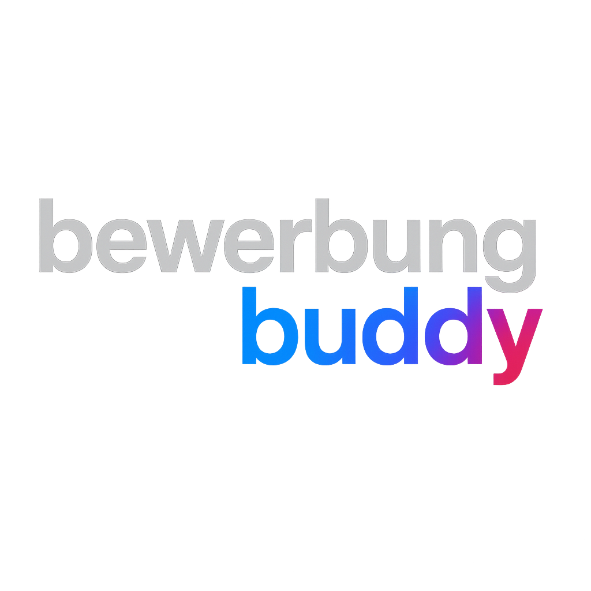

<h1 align="center">Hi, I'm Nikolai 👋</h1>

  🇩🇪 Fulda · 5th‑semester B.Sc. Applied Computer Science @ Hochschule Fulda 
  💼 Working Student (Backend) @ Deloitte 
  🛠️ Backend (Java/Spring) — clean architecture, tests, CI/CD · ☁️ Self‑hosting & MLOps

---

### 🚀 About

- 💼 **Working student at Deloitte** — Java / Spring Boot backend development in a multi‑module enterprise codebase
- 📚 Current GPA: **1.4**
- 💡 Focus: **Java 25 / Spring Boot 4 · Databases (PostgreSQL, MongoDB)**, rigorous architecture, reliable pipelines, expanding into **MLOps & ML/DL**
- 🧩 Teaming on **MassiveMarketManager** — joint trading bot project built with **ML/AI** for DeFi markets
- 🚀 Improving **BewerbungBuddy** — full-stack app with Spring Boot + OpenAI API for CV analysis
- 🖥️ Running my own infrastructure: **K3s on a Hetzner VPS**, self‑hosted **Matrix** server and VPN
- 🏆 Practicing algorithms on Codeforces: [Profile](https://codeforces.com/profile/NII00K)
- 🌍 Languages: 🇷🇺 Russian · 🇩🇪 German (C1) · 🇬🇧 English (C1) · 🇳🇴 Norwegian (beginner)

---

### 🗂️ Projects

  

#### 💼 [MassiveMarketManager](https://github.com/MassiveMarketManager/MassiveMarketManager-MMM)
Collaborative **trading bot for DeFi markets** powered by **ML/AI** and smart contract execution.

Stack: **Java 25 • Spring Boot • Maven • MapStruct • Lombok • JPA/Hibernate • PostgreSQL • Flyway • Docker • GitHub Actions • GHCR**

- Modular architecture with strict layering (API → Service → Persistence)
- Automated CI/CD pipelines (build/test, containerized delivery)
- Road ahead: Basic Backend structure, frontend draft with **``React``**

---

  

#### 📝 [BewerbungBuddy](https://github.com/nikolai-milenko/BewerbungBuddy) (bewerbungbuddy.de)
AI-powered career assistant that not only parses CVs and drafts tailored cover letters, but also provides feedback on structure, style, and consistency, as well as highlights missing skills.

Stack: **Java 21 • Spring Boot • JPA/PostgreSQL • MapStruct • Docker Compose • GitLab CI/CD • OpenAI API • Bootstrap**

- Multi‑module repo (backend + static frontend)
- Strongly typed domain model (CVAnalysis, DTOs, mappers)
- CI/CD and containerized deploy

---

#### ⚙️ ML Pipelines on GitHub Actions *(university team project, WiSe 2026/27)*
MLOps platform for ML/AI engineers built on **GitHub Actions**: configurable pipeline steps for data preparation, training, testing, model comparison and reporting — with compute limits, artifact management and recovery mechanisms.

---

#### 🗄️ Self‑hosted Git Platform *(university project, WiSe 2026/27)*
Self‑hosted Git service (Gitea/Forgejo‑style) set up and operated on a university VM — networking, system administration, TLS.

---

#### 📚 Studienplaner
Student planner backend (MVP) with Spring Boot.

---

### 🛠️ Tech

**Languages & Frameworks**

**Data**

**Tools & Platforms**

**Also used:** `Javers` · `gRPC / Protobuf` · `SAP BW/4HANA` · `ROS 2` · `Qt` · `PyQt5` · `JavaFX` · `Assembler (MASM, NASM)`

---

### 🔭 Currently learning
- MLOps (model versioning, monitoring, reproducible pipelines)
- Event‑driven architectures & Kafka
- Infrastructure as Code (Terraform) & observability (Prometheus / Grafana)
- PyTorch & transformer‑based models

### 📌 Open to
- Collaboration on backend / ML / self‑hosting projects
- Bachelor thesis topics in backend, MLOps or cloud infrastructure

---

### 📊 GitHub Stats

### 🏆 Trophies

---

### 📫 Contact

